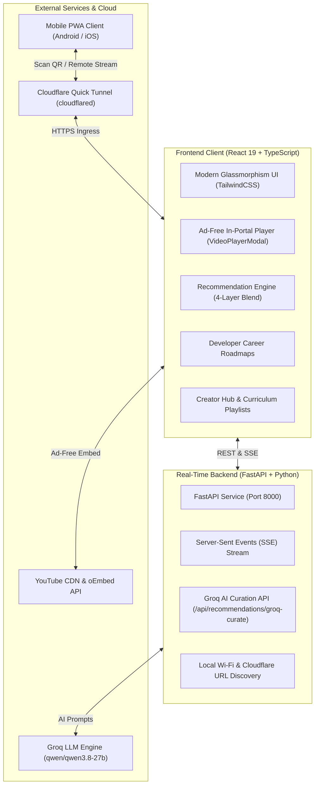
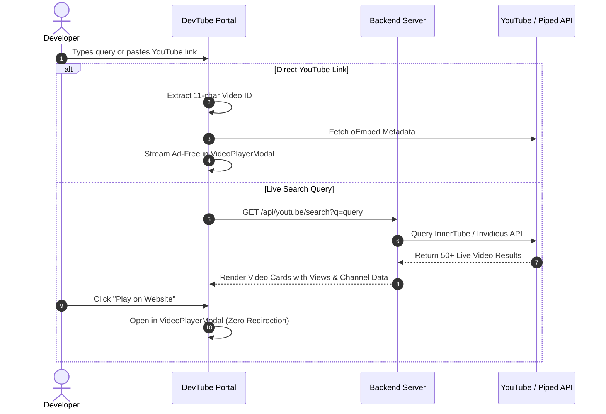

# 🏗️ Technical Architecture: DevTube

## 1. System Overview

DevTube connects a responsive React 19 single-page application with a high-performance Python FastAPI backend, a Groq AI reasoning engine, and a secure Cloudflare HTTPS edge tunnel.



---

## 2. Frontend Component Hierarchy

* **`src/App.tsx`**:
  * Global state management (theme, records, active tab, notification subscription).
  * Header layout with live catalog reload, notifications, theme switcher, and navigation.
  * In-portal modal player mounting (`VideoPlayerModal`).
* **`src/components/VideoPlayerModal.tsx`**:
  * In-portal video player with sandbox isolation:
    ```html
    sandbox="allow-scripts allow-same-origin allow-presentation allow-forms"
    ```
  * Mode switchers: `🛡️ Ad-Free HD` (No-cookie), `▶ Standard YouTube` (Fallback for restricted embeds), and `⚡ Proxy Stream` (Invidious / Piped).
  * Direct Universal Stream bar: Paste ANY YouTube link or ID to stream instantly.
  * In-modal related carousel: Allows continuous sequential playback of curriculum masterclasses without leaving the website.
* **`src/components/AIRecommendations.tsx`**:
  * View 1: **Developer Role Roadmaps** (AI/ML Engineer, Full-Stack, DevOps/Cloud, FAANG DSA, Cybersecurity).
  * View 2: **Groq AI Live Curation** (Real-time goal input, custom prompt presets, curriculum steps).
  * View 3: **Algorithmic Strategy Feed** (Hybrid, Category Affinity, User Collaborative, Trending).
  * Topic Quick Chips with live video counts across all categories.
* **`src/components/ChannelHub.tsx`**:
  * Curated Creator Hubs with verified Google CDN avatars.
  * Multi-playlist curriculum tracking (e.g. Krish Naik Agentic AI, Machine Learning, Deep Learning).
  * "Same Types of Videos" affinity discovery.
* **`src/components/InstallAppButton.tsx`**:
  * Standalone PWA install button and modal.
  * Renders a perfectly square, high-definition QR code for instant mobile phone camera scanning.
  * Dual-mode connection toggle: Cloudflare HTTPS (anywhere in the world) vs Local Wi-Fi network.

---

## 3. Backend Architecture (`scripts/realtime_server.py`)

* **FastAPI Application**:
  * Hosted on `http://127.0.0.1:8000`.
  * Runs asynchronously via `uvicorn`.
* **Endpoints**:
  * `POST /api/recommendations/groq-curate`: Uses Groq's `qwen/qwen3.8-27b` model to dynamically rank and structure candidate videos into step-by-step curricula with learning rationale.
  * `GET /api/notifications/stream`: Real-time Server-Sent Events (SSE) broadcasting catalog syncs and live alerts.
  * `POST /api/notifications/broadcast`: Dispatches notifications to all connected mobile and web clients.
  * `GET /api/network-info`: Discovers host IP address (`10.251.69.204`), active port (`3000`), and live Cloudflare tunnel URL.

---

## 4. Universal YouTube Architecture (How to Scale to 800M+ Videos)


