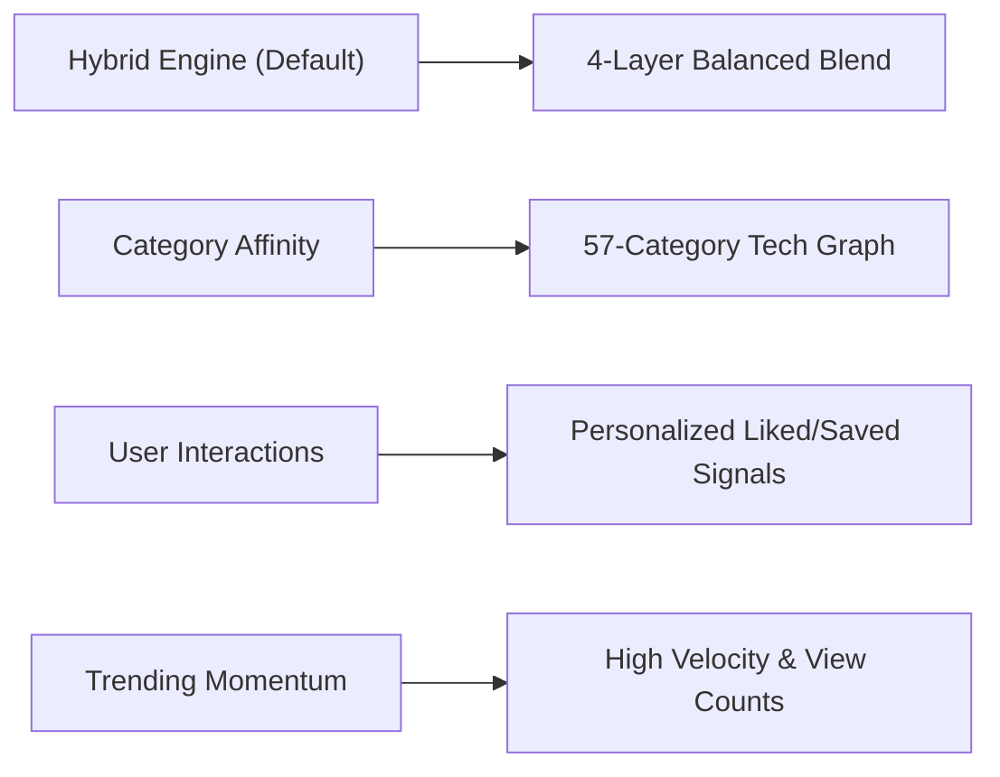

# 🧠 DevTube Recommendation System Specification

## Overview

DevTube implements a **multi-strategy, 4-layer recommendation engine** designed specifically to help software developers learn technologies in structured, sequential depth rather than superficial viral clicks.

---

## 📐 Algorithmic Scoring Formula

For any candidate video $V$ given user interactions $U$, date filter $D$, and active strategy $S$, the recommendation engine computes a unified composite score:

$$\text{FinalScore}(V) = w_c \cdot S_{\text{content}} + w_a \cdot S_{\text{affinity}} + w_u \cdot S_{\text{user}} + w_t \cdot S_{\text{recency}} + w_v \cdot S_{\text{velocity}}$$

Where:
* $S_{\text{content}}$: Keyword & category relevance to the active domain/topic (0–100).
* $S_{\text{affinity}}$: Graph distance in the 57-category knowledge graph (e.g. learning Python boosts Data Science and FastAPI).
* $S_{\text{user}}$: Implicit and explicit user signals (Liked videos: +40 pts, Bookmarked: +60 pts, Watched: +20 pts).
* $S_{\text{recency}}$: Temporal freshness multiplier configured by the user's recency weight slider.
* $S_{\text{velocity}}$: Authentic view counts and creator reputation weight.

---

## 🎯 The 4 Recommendation Strategies

### 1. ⚡ Hybrid AI Engine (Default)
Blends content relevance, category graph correlation, user interaction history, and temporal freshness into a single balanced ranking.

### 2. 🌐 Category Affinity Knowledge Graph
Uses the graph relationships between the 57 categories defined in `src/taxonomy.ts`:
* When a user studies **Generative AI (#5)**, the engine cross-recommends:
  * **Deep Learning (#2)**
  * **Model Deployment (MLOps) (#8)**
  * **Data Engineering (#44)**
* When a user studies **Kubernetes & Containerization (#31)**, the engine cross-recommends:
  * **CI/CD Pipelines (#30)**
  * **Infrastructure as Code (#32)**
  * **Microservices Architecture (#37)**

### 3. ❤️ User Collaborative & Interaction Learning
Prioritizes topics that the developer has liked or bookmarked. Dismissed topics are penalized to avoid repetitive feeds.

### 4. 🔥 Trending Velocity
Surfaces high-momentum masterclasses with proven view counts and community validation from verified creators.

---

## 🤖 Groq LLM Semantic Curation (`qwen/qwen3.8-27b`)

DevTube integrates Groq's high-speed inference engine via `POST /api/recommendations/groq-curate`:
1. **Developer Goal Input**: The developer specifies their exact career target (e.g. *"I want to master AI Agents and LangGraph with Krish Naik"*).
2. **Context Packaging**: The backend packages top catalog candidates with their domains, tags, and category metadata.
3. **Structured Output**: Groq outputs a structured JSON curriculum:
   * **Persona Summary**: 2-sentence rationale explaining the learning path.
   * **Key Role Competencies**: Essential skills required for the role.
   * **Ordered Recommendations**: Step 1, Step 2, Step 3... with relevance scores and explanation tags.
