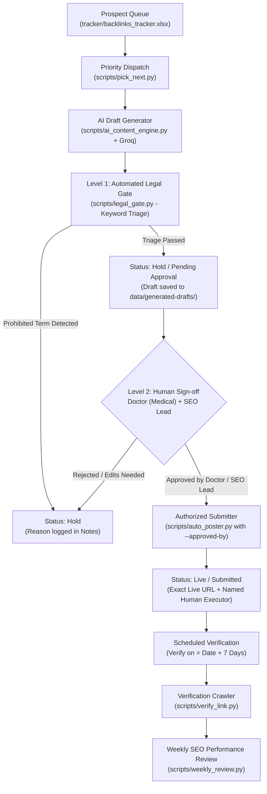
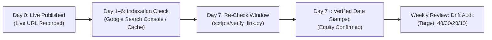

# Real-Time AI Backlink & Recommendation System — Architecture & Operations Guide

Comprehensive technical and operational guide aligning the AI-assisted backlink pipeline with the strict requirements of [docs/SOP.md](docs/SOP.md).

---

## 1. System Overview & Clean Separation of Concerns

The workspace contains two decoupled capabilities:

1. **Backlink Execution Pipeline** (SOP Steps 1–9): An assisted workflow for researching, drafting, reviewing, submitting, recording, and verifying backlinks for QHT Clinic and URoots.
2. **Apify Intelligence Module** (`scripts/apify_service.py`): A research and ideation tool that pulls video metadata and transcripts to inform topic selection. **This scraper is for content research only and is not part of the backlink submission pipeline.**

---

## 2. The Backlink Pipeline with Human-in-the-Loop Sign-off

To comply with SOP requirements (doctor-reviewed health content, original text per site, named executor, and strict anti-spam rules), the system implements an **AI-Assisted, Human-Approved** architecture:



---

## 3. Core Safety & Compliance Guardrails

### 3.1. Human-in-the-Loop Approval (Addressing Auto-Posting Risk)
* **The Rule**: Automated keyword matching can never substitute for qualified medical and legal sign-off.
* **The Implementation**:
  * Generated drafts are **never published directly**.
  * After passing the keyword gate, rows are held with notes: `Draft ready — waiting for Doctor / SEO Lead sign-off (SOP Step 4)`.
  * The posting script (`scripts/auto_poster.py`) requires an explicit authorization flag:
    ```powershell
    python scripts/auto_poster.py --row 2 --approved-by "Dr. Rajesh Sharma" --executor "Asha"
    ```
  * Without `--approved-by`, the system saves the draft, marks `Status = Hold`, and refuses to push content live.
  * The executor is always recorded as a **named human operator** (e.g., `Asha`), never an anonymous `AI-Agent`.

### 3.2. Preventing Duplicate Content (Addressing Batch Posting Risk)
* **The Rule**: SOP Step 5 strictly bans spun, copied, or syndicated duplicate text. Publishing identical content across multiple websites creates a link footprint that triggers search engine penalties.
* **The Implementation**:
  * Batch posting identical articles across sites is strictly restricted.
  * For multi-site targets, `scripts/batch_poster.py` must generate **distinct, customized variants** tailored to each host domain and link type (e.g., a 100-word directory bio vs. a 500-word guest blog).
  * Each variant must undergo individual legal triage and human sign-off before submission.

### 3.3. Legal Gate as Preliminary Triage (Not Final Authority)
* **The Rule**: Regex and keyword matching cannot catch every misspelling, context nuance, or unlisted drug.
* **The Implementation**:
  * `scripts/legal_gate.py` acts as a **preliminary screening filter (first line of defense)**.
  * It scans for known Rx names (`minoxidil`, `minoxidill`, `finasteride`, `finasterid`, `dutasteride`), competitor brands (`Traya`, `Man Matters`, `Bodywise`), and prohibited claims (`guaranteed results`, `permanent solution`, `100% cure`).
  * If a violation is found, the script immediately exits non-zero and marks the row `Hold`.
  * If it passes, human doctor sign-off remains mandatory before publishing.

---

## 4. Status Codes, Attributes, and Metric Definitions

To ensure strict alignment between SOP Section 6 and this system guide:

### 4.1. Canonical Status Codes
Only these 7 status values are valid in `tracker/backlinks_tracker.xlsx`:
* **`Not started`**: Row is queued.
* **`In progress`**: Claimed by an executor; work is active.
* **`Submitted`**: Sent to third-party publisher; waiting for editor review.
* **`Live`**: Published on host site.
* **`Hold`**: Awaiting doctor sign-off, legal clearance, payment decision, or asset details.
* **`Skip`**: Site rejected (spam, irrelevant, toxic).
* **`Removed`**: Link was previously live and later deleted or dropped.

> **Important**: `Verified` is **not** a status code. Successful 7-day confirmation is recorded by stamping the date in the **`Verified date`** column. Similarly, `Nofollow` is a link attribute recorded in the **`Dofollow / Nofollow`** column.

### 4.2. Immediate vs. Weekly Removal Handling
* **Immediate Action**: When the verification crawler detects a dead page (HTTP 404/410) or a missing target backlink, it immediately sets `Status = Removed`, logs the timestamp and failure details in `Notes`, and alerts the operator.
* **Weekly Action**: `scripts/weekly_review.py` aggregates all links removed during the cycle for the SEO lead to make scale/drop decisions.

### 4.3. Standardized Verification Command
To eliminate ambiguity, use the unified pipeline runner for batch verification:
```powershell
python scripts/pipeline_runner.py --verify-all
```
*(This command internally invokes `scripts/auto_verify_worker.py` across all rows where `Verify on` has matured).*

---

## 5. Technical Architecture & Risk Controls

### 5.1. Concurrency & Excel File Locking
* **Limitation**: Direct concurrent read/write operations on `tracker/backlinks_tracker.xlsx` from multiple background scripts, web dashboards, and operators can lead to file-lock collisions (`PermissionError`) or workbook corruption.
* **Architecture Standard**:
  * In multi-user production environments, a transactional database (SQLite or PostgreSQL) serves as the concurrency-safe single source of truth.
  * The Excel spreadsheet is treated as a generated export and audit trail snapshot.
  * In file-based environments, scripts operate sequentially and close workbook handles immediately upon atomic save.

### 5.2. Credential Security & API Isolation
* **Storage**: Passwords and private API tokens are strictly prohibited from appearing in tracker sheets or repository files.
* **Environment Isolation**:
  * Credentials (`GROQ_API_KEY`, `APIFY_API_TOKEN`, CMS application keys) reside exclusively in `.env`, which is permanently listed in `.gitignore`.
  * Production deployment of the FastAPI backend (`http://127.0.0.1:8000`) requires Bearer token authentication and CORS restriction before exposure beyond localhost.

### 5.3. Enhanced Link Verification Checks
The verification crawler (`scripts/verify_link.py`) verifies link equity through comprehensive inspection:
1. **HTTP Status Code**: Verifies 200 OK. Flags 301/302 redirects if redirected to an unrelated URL.
2. **Anchor Text & Target URL**: Confirms the anchor is present in the rendered HTML and targets the correct clinic page.
3. **Robots Indexation**: Checks the HTML `<head>` for `<meta name="robots" content="noindex">`.
4. **Rel Attributes**: Detects `rel="nofollow"`, `rel="sponsored"`, and `rel="ugc"`.
5. **Visibility**: Flags links placed in hidden containers (`display:none` or `visibility:hidden`).

### 5.4. Verified Groq Model Discovery
* Groq models are configured in `scripts/ai_content_engine.py` within the `generate_with_llm()` function.
* The active model confirmed on this account is **`qwen/qwen3.8-27b`**, with fallback to **`openai/gpt-oss-120b`** and **`openai/gpt-oss-20b`**.
* The engine executes runtime discovery via `client.models.list()` to avoid silent request failures from decommissioned model tags.

---

## 6. Post-Publication Lifecycle & SEO Review

The lifecycle following link publication centers on indexation, equity verification, and portfolio balance:



### 6.1. Indexation & Referral Verification
* **Google Search Console**: The SEO lead monitors new referring domains to confirm the published link is crawled and recognized by Google.
* **Referral Monitoring**: Tracking referral sessions to ensure traffic quality from health-relevant placements.

### 6.2. Anchor-Mix Drift Tolerance
SOP Step 5 and `config/campaign.yaml` specify the portfolio anchor distribution:
* Brand anchors: **40%**
* Partial keyword anchors: **30%**
* Plain URL anchors: **20%**
* Generic anchors: **10%**

> **Drift Rule**: The drift tolerance is **10 percentage points (pp)** absolute drift (`drift_tolerance_pp: 10`). For example, if Brand anchors drift above 50% or below 30%, `scripts/weekly_review.py` triggers an audit warning: `⚠ fix next week's rows`, instructing executors to rebalance upcoming selections.

---

## 7. Operations & Customization Reference

### 7.1. Adding New Site Prospects
To add targets to the campaign:
1. Open `tracker/backlinks_tracker.xlsx` or append to `data/site_prospects.csv`.
2. Populate: `Brand`, `Site / URL`, `Decision` (`Do first`), `Target page`, `Anchor`, `Word count`.
3. Set `Status` = `Not started`.

### 7.2. Customizing Asset Kits
Clinic details and medical review credentials reside in:
* QHT Clinic: `asset-kit/qht-clinic/kit.md`
* URoots: `asset-kit/uroots/kit.md`

Always copy verified author credentials and clinic NAP from these files; never retype details directly onto target sites.

### 7.3. Quick Execution Commands

```powershell
# 1. Run Preflight Audit (Must be CLEAR before submissions)
python scripts/checklist.py preflight

# 2. Claim Next Eligible Queue Row
python scripts/pick_next.py --claim --executor "YourName"

# 3. Generate Draft & Run Preliminary Legal Triage
python scripts/ai_content_engine.py --row 2

# 4. Authorize and Record Live Publication (Requires Human Sign-off)
python scripts/auto_poster.py --row 2 --approved-by "Dr. Rajesh Sharma" --executor "YourName"

# 5. Run Comprehensive Link Verification (HTTP 200, Anchor, Noindex)
python scripts/pipeline_runner.py --verify-all

# 6. Generate Weekly SEO Review & Anchor-Mix Audit
python scripts/weekly_review.py
```
